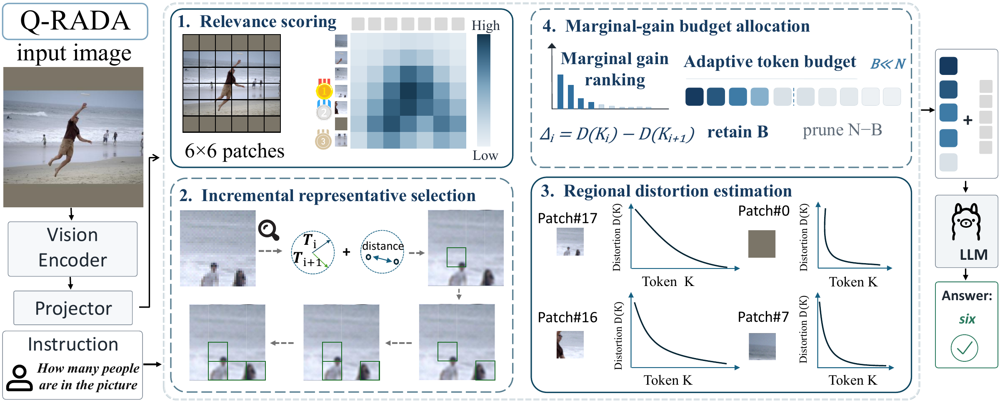
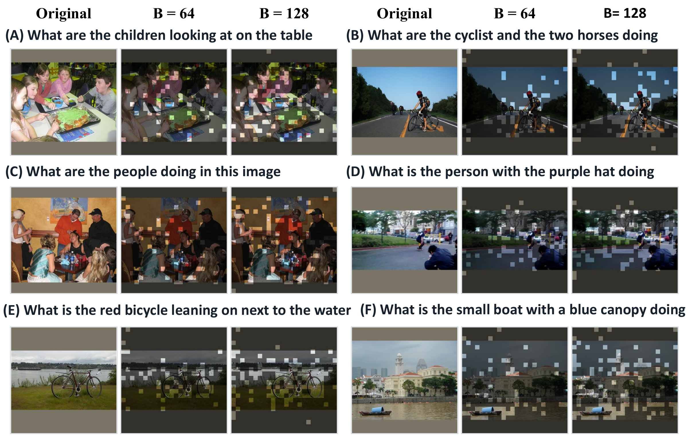
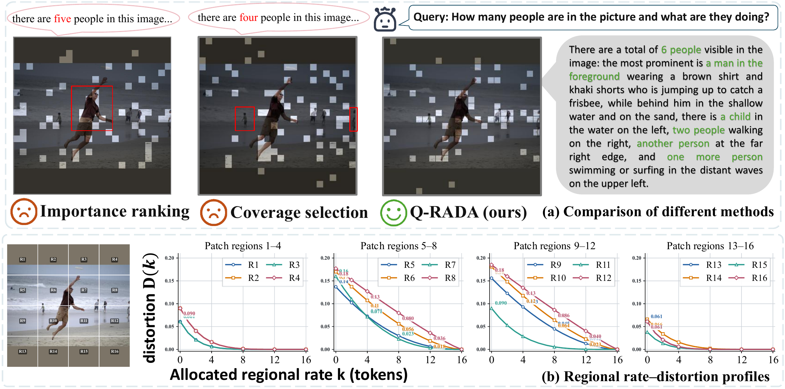
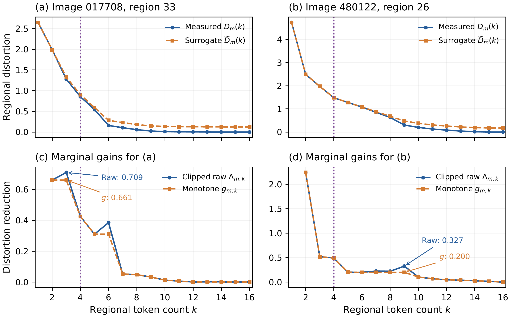
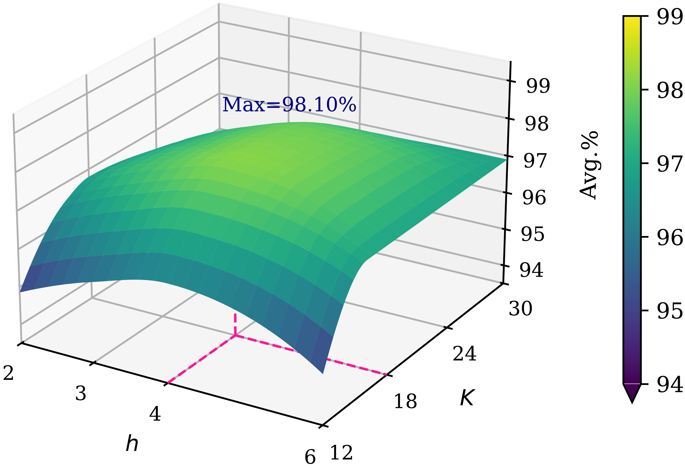

# Q-RADA

### Which Region Gets the Next Token? Query-Conditioned Visual Token Pruning via Marginal Gains

**Deng Luo · Dongyang Zhang · Shuang Liang · Man-Fai Leung · Ke Qin**

Training-free visual token pruning with a strict global budget.

[Method](#method) · [Results](#results) · [Visualizations](#visualizations) · [Release status](#release-status) · [Citation](#citation) · [中文](README.zh-CN.md)

## Highlights

- **97.1%** of full-token aggregate performance with **64 / 576 visual tokens** on LLaVA-1.5-7B, an **88.9% token reduction**.
- **92.3% fewer average assembled visual tokens** and **1.87x end-to-end speedup** on POPE with LLaVA-NeXT-7B: 2,280 → 175 tokens, with accuracy **86.80% → 87.50%**.
- Evaluated across LLaVA-1.5, LLaVA-NeXT, Qwen2.5-VL, and LLaVA-Video with frozen pretrained models.

## Method

Which query-relevant region should receive the next token? Relevance alone does not determine how many tokens a region needs: a simple object may need only a few, while several small instances can require more capacity.

Q-RADA operates on projected visual tokens before language-model inference:

1. **Score regional relevance.** Partition the visual grid into spatial regions and identify eligible regions using a frozen paired vision-text encoder.
2. **Select regional representatives.** Build nested representative sets using query relevance together with feature and spatial distances.
3. **Estimate regional distortion.** Measure relevance-weighted feature distortion as each region receives additional tokens.
4. **Allocate the budget by marginal gain.** Convert clipped distortion reductions into conservative, non-increasing surrogate gains, then repeatedly assign the next token to the region with the largest available gain until exactly `B` outputs are allocated.

The greedy allocator exactly optimizes the constructed separable surrogate objective under a feasible strict budget. This guarantee applies to the surrogate objective, rather than downstream answer accuracy. No model training or parameter updates are required.

## Results

### Image understanding

| Backbone | Retained visual tokens | Relative aggregate score (Avg.%) |
| --- | --- | --- |
| LLaVA-1.5-7B | 192 / 576 | 99.7% |
| LLaVA-1.5-7B | 128 / 576 | 98.6% |
| LLaVA-1.5-7B | 64 / 576 | **97.1%** |
| LLaVA-NeXT-7B | 640, nominal budget | 100.6% |
| LLaVA-NeXT-7B | 320, nominal budget | 98.4% |
| Qwen2.5-VL-7B | 512 / 1,296 | 100.5% |
| Qwen2.5-VL-7B | 256 / 1,296 | 98.4% |
| Qwen2.5-VL-7B | 128 / 1,296 | 95.2% |

`Avg.%` values are copied from the manuscript and normalized to the full-token reference in each table. They are not averages of raw benchmark scores; values above 100% do not imply improvements on every task. See [full tables and reporting notes](docs/RESULTS.md).

### LLaVA-1.5-7B at 64 visual tokens

| Method | Visual tokens | GQA | MME | POPE | Avg.% |
| --- | --- | --- | --- | --- | --- |
| LLaVA-1.5-7B | 576 | 61.9 | 1862.0 | 85.9 | 100.0% |
| FastV (ECCV'24) | 64 | 46.1 | 1256.0 | 48.0 | 74.3% |
| SparseVLM (ICML'25) | 64 | 52.7 | 1505.0 | 75.1 | 87.2% |
| VisionZip (CVPR'25) | 64 | 55.1 | 1690.0 | 77.0 | 93.6% |
| DART (EMNLP'25) | 64 | 54.7 | 1705.0 | 73.9 | 92.8% |
| DivPrune (CVPR'25) | 64 | 57.8 | 1674.0 | 85.6 | 95.2% |
| SCOPE (NeurIPS'25) | 64 | 58.3 | 1698.0 | 86.4 | 96.7% |
| V2Drop (CVPR'26) | 64 | 50.5 | 1470.0 | 75.1 | 88.2% |
| AgilePruner (ICLR'26) | 64 | 57.4 | 1703.0 | 74.1 | 94.3% |
| Q-RADA (ours) | 64 | 58.5 | 1727.0 | 87.5 | 97.1% |

This comparison shows selected metrics from the eight-benchmark main table. [All benchmark scores and budgets](docs/RESULTS.md#llava-15-7b) are provided alongside CSV and LaTeX versions.

### Inference efficiency on POPE

All rows use LLaVA-NeXT-7B. The token counts below are averages of the assembled visual sequences, which differ from the nominal budgets in the accuracy table.

| Method | Avg. visual tokens | Mean latency (s) | P95 latency (s) | Speedup | Peak memory (GiB) | Accuracy (%) | F1 (%) |
| --- | --- | --- | --- | --- | --- | --- | --- |
| Full-token baseline | 2,280 | 0.33 | 0.40 | 1.00x | 15.03 | 86.80 | 86.40 |
| Q-RADA | 320 | 0.21 | 0.23 | 1.57x | 14.65 | 88.24 | 87.02 |
| **Q-RADA** | **175** | **0.17** | **0.18** | **1.87x** | **14.09** | **87.50** | **86.90** |
| Q-RADA | 80 | 0.15 | 0.17 | 2.20x | 13.89 | 86.93 | 86.31 |

The manuscript reports experiments on two NVIDIA RTX 4090 D GPUs. Latencies are rounded for display; speedups use the unrounded mean latencies. These are reported manuscript measurements.

### Video understanding

| Method | Frames x tokens/frame | Video-MME Short | Video-MME Medium | Video-MME Long | MVBench |
| --- | --- | --- | --- | --- | --- |
| LLaVA-Video-7B, full tokens | 64 x 169 | 76.6 | 61.2 | 53.1 | 58.2 |
| Q-RADA | 64 x 32 | 71.9 | 58.9 | 51.1 | **60.3** |
| Q-RADA | 64 x 16 | 68.8 | 56.6 | 49.7 | 58.4 |

See [complete results](docs/RESULTS.md) for baseline comparisons, ablations, extreme compression, and transfer to LLaVA-1.5-13B. [CSV files](results/) and [original table excerpts](results/latex/) are included for reuse and checking.

## Visualizations

### Query-aware token allocation

Examples show the original images and retained visual evidence under global token budgets `B=64` and `B=128`.

Motivation, regional curves, and parameter sensitivity

The motivation figure illustrates qualitative responses at a 64-token budget and regional distortion profiles. The profiles show different saturation patterns; they do not report final regional allocations.

Measured distortion, induced surrogate distortion, clipped raw reductions, and non-increasing gains on two COCO validation images. The illustrated regions each receive four tokens under a 64-token image budget (`h=4`, `K=18`).

Sensitivity to region size `h` and eligible-region count `K` under a 64-token budget. The peak of 98.1% corresponds to the five-benchmark analysis setting; the main eight-benchmark result is 97.1%.

